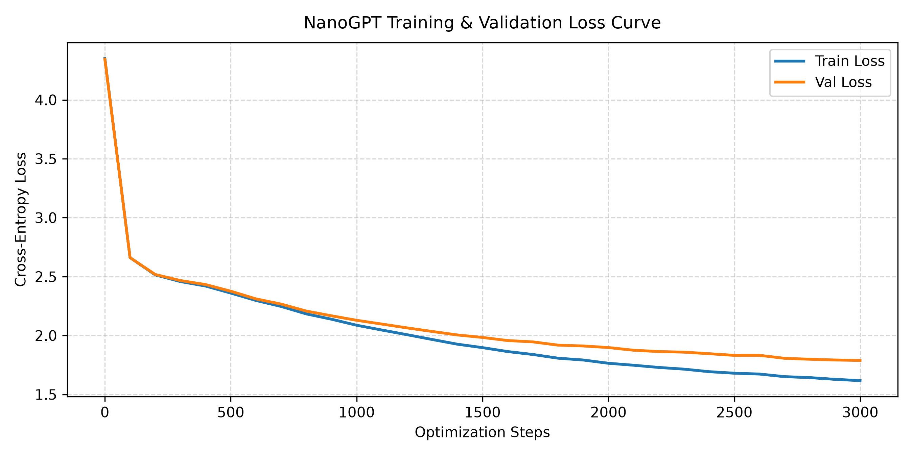

# LAB 1 (src/gpt.py)

## Lab 1: nanoGPT Implementation & Training

Lab 1 focuses on building and training a decoder-only Transformer from scratch using character-level tokenization. The model architecture follows Andrej Karpathy's *nanoGPT* design and is scaled for efficient local execution and verification.

### Architectural Specifications & Hyperparameters

- **Vocabulary Size ($V$):** 65 unique characters (Tiny Shakespeare corpus)
- **Context Length ($T$):** 128 tokens
- **Embedding Dimension ($d_{\text{model}}$):** 128
- **Total Parameters:** $\sim 0.8\text{M}$
- **Batch Size:** 64
- **Training Iterations:** 3,000 steps

---

## Training Convergence & Loss Diagnostics

The model tracks training and validation loss every 100 iterations over 200 random batches:

- **Initial Loss:** $\sim 4.17$ (matches theoretical random initialization: $-\ln(1/65) \approx 4.17$)
- **Final Validation Loss:** $\sim 1.65 - 1.75$

### Loss Curve

---

## References

1. **Karpathy, A.** (2023). *Let's build GPT: from scratch, in code, spelled out.* nanoGPT repository: [github.com/karpathy/nanoGPT](https://github.com/karpathy/nanoGPT).
